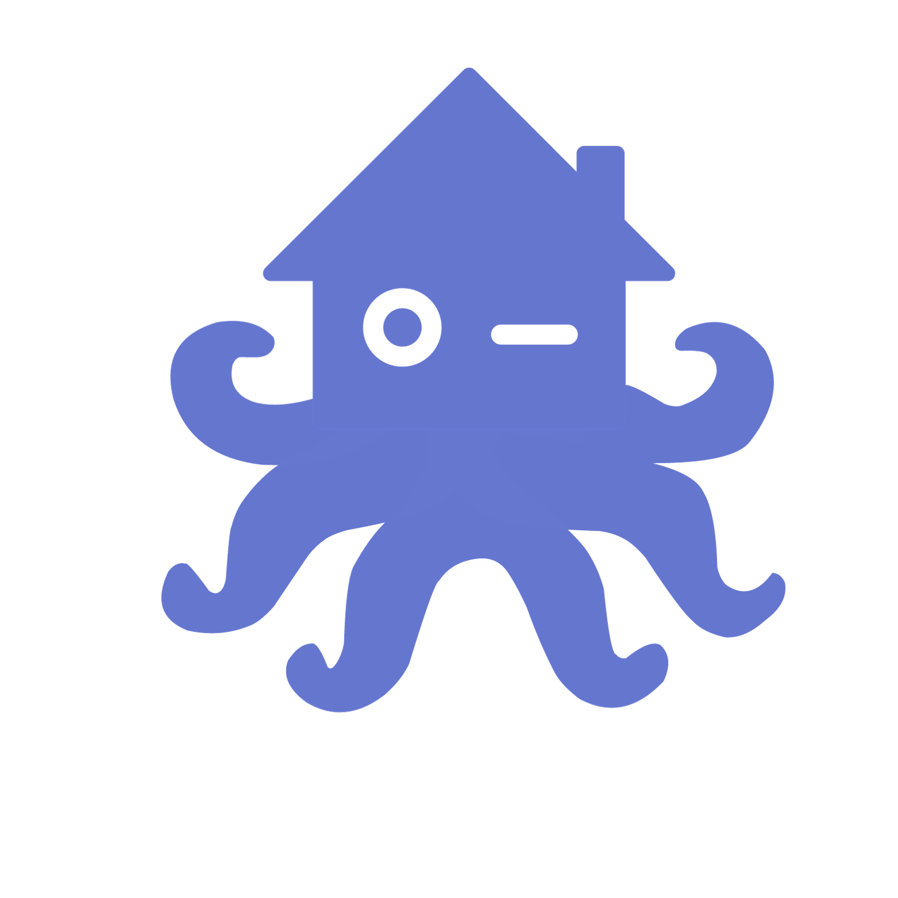
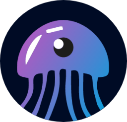

<p align="center">
  
</p>

<h1 align="center"> Polvo- </h1>

<p align="center">
  <b> Bem-vindo ao meu projeto de home server!  </b></br>
  <sub> Navegando os mares, um dia de cada vez.
</p>

<p align="center">
  <a href="#Introdução"> 🧭Introdução </a>&nbsp;|&nbsp;
  <a href="#Objetivo"> 🎯Objetivo </a>&nbsp;|&nbsp;
  <a href="#Serviços"> 🐳Serviços </a>&nbsp;|&nbsp;
  <a href="#Como usar"> 🤔Como usar </a>&nbsp;|&nbsp;
  <a href="#Requisitos"> 📋Requisitos </a>&nbsp;|&nbsp;
  <a href="#Instalação">🔧Instalação </a>&nbsp;|&nbsp;
  <a href="#Contribuição"> 🤝Contribuição </a>&nbsp;|&nbsp;&nbsp;&nbsp;
  <a href="#Roadmap"> 🗺️Roadmap </a>&nbsp;|&nbsp;
</p>

> Disclaimer: eu, bem como os desenvolvedores das aplicações usadas ​​neste artigo não toleram ou incentivam o download, o compartilhamento, a propagação ou o peering de material protegido por direitos autorais. As leis nacionais e internacionais proíbem atividades ilegais. Este projeto serve apenas para fins educacionais

<a id="Introdução"></a>
## O que é este projeto?

Este projeto é um ambiente de servidor doméstico que eu criei para atender a minha jornada de autodescobrimento. Aqui está um pouco do meu conhecimento que eu aprendi ao longo do tempo, bem como alguns erros e acertos que podem ser vistos de acordo com sua experiência na área. 

Sinta-se à vontade para clonar o repositório e fazer do meu ambiente o seu próprio, afinal, tudo isso aqui é FOSS :)

Este projeto até o momento tende a ter uma estrutura baseada em contêineres.

A estrutura aqui no github será dividida em pastas; a root sendo o meu servidor físico (o meu famoso macbook que chamo carinhosamente de crapbook); um servidor VPS na OCI e; um Raspberry Pi 3B

A estrutura de arquivos YML também estão divididos:

- core.yml -> Serviços de monitoramento, proxy reverso, atualizações automáticas de containeres e dashboard.
- media-stack.yml -> Serviços de mídia que são dependentes entre si.

<a id="Objetivo"></a>
## Objetivo

O principal objetivo com esse projeto é descobrir novas tecnologias e jeitos de incorporar softwares geralmente inalcançáveis em algo tangível e simples. 

Ué, como assim?

Muitas das tecnologias que usamos diariamente são encontradas apenas em grandes empresas, com códigos fechados e com uma política restritiva. 

Levando em consideração a filosofia do próprio linux, eu como um profissional da área de segurança da informação não acredito que as coisas deveriam ter essa política agressiva para com os usuários, e, portanto, busco de certa forma implementar as mesmas coisas de grandes empresas no meu próprio ambiente, utilizando meus recursos e perpetuando a transparência como acredito que as coisas deveriam ser.

<a id="Serviços"></a>
## Serviços

### Traefik - Proxy reverso FTW

</br>

O Traefik é a porta de entrada. Ele atua proxy reverso no ambiente, direcionando o tráfego remoto e local para os serviços corretos no meu servidor. Eis o que ele basicamente faz:

* Roteamento dinâmico de tráfego para diferentes serviços
* Suporte a HTTPS com Let's Encrypt para segurança aprimorada*
* Um painel de controle amigável para gerenciar minhas configurações

A configuração do Traefik a princípio é algo um pouco complexo, ainda mais quando é sua primeira implementação do serviço. Depois de um tempo ele começa a se tornar muito simples, com cada serviço que é adicionado no arquivo de docker-compose basta adicionar labels para que haja a integração com o proxy.

### What's up, Docker? - Monitoramento automatizado

</br>

O "What's Up Docker?" é como meu assistente pessoal digital que monitora meus contêineres em tempo real. Aqui estão algumas funções:

* Receber atualizações instantâneas sobre meus contêineres
* Verificar o status dos contêineres
* Realizar ações de manutenção diretamente do meu navegador
* Atualização automática dos contêineres*

### Jellyfin - Minha central de mídia

</br>

O Jellyfin é a resposta para todas as minhas necessidades de mídia. Ele é a aplicação que gerencio e reproduzo meus filmes e programas de TV:

* Organizar minha biblioteca de mídia
* Transmitir conteúdo para todos os meus dispositivos na rede local

O Jellyfin é uma alternativa bem forte frente aos serviços como o Plex ou Emby.

Se quiser um comparativo mais aprofundado, sugiro esse [repo](https://github.com/Protektor-Desura/Archon/wiki/Compare-Media-Servers) aqui.

### Jellyseerr - Gerenciamento de solicitações de mídia

</br>

O Jellyseerr é meu assistente dedicado ao Jellyfin, me ajudando a gerenciar as solicitações da minha biblioteca de mídia:

* Aceitar, processar e gerenciar solicitações de mídia
* Garantir que meus amigos e familiares obtenham o que desejam
* Simplificar a organização da minha biblioteca

### Plex - Backup central mídia

</br>
 
O Plex também é a resposta para todas as minhas necessidades de mídia, porém aqui ele fica de coadjuvante. Aqui estão alguns dos benefícios:

* Transmissão de mídia local e remota
* Organização eficiente da coleção de filmes, séries e música
* Acesso simplificado a partir de dispositivos de sua escolha

### Overseerr - Gerenciamento de solicitações de mídia para o plex

</br>

O Overseerr é meu assistente dedicado ao Plex, me ajudando a gerenciar as solicitações da minha biblioteca de mídia, também de modo secundário. Aqui estão alguns pontos:

* Acompanhamento e organização de pedidos de filmes e séries
* Integração perfeita com o Plex e outras fontes de mídia
* Integração com o Tautulli
* Garantia de que todos tenham acesso ao conteúdo que desejam

### Tautulli - Monitoramento Inteligente do Plex

</br>

O Tautulli é o companheiro inteligente para monitorar e acompanhar a atividade do Plex:

* Estatísticas detalhadas sobre o uso do Plex dos usuários locais e remotos
* Notificações personalizadas para eventos importantes
* Ajuda na otimização da experiência de streaming da biblioteca de mídia

### Gotify - Notificações Simplificadas

</br>

O Gotify é a solução de notificação perfeita para me manter atualizado sobre os meus aplicativos e serviços, oferecendo:

* Notificações centralizadas para todos os seus aplicativos e servidores
* Personalização de alertas para atender às suas necessidades
* Controle total sobre suas mensagens e notificações

### Uptime-Kuma - Monitoramento da disponibilidade dos contêineres

</br>

O Uptime-Kuma me mantem informado sobre o status de todos os meus contêineres. Ele basicamente:

* Mandar alertas instantâneos sobre quedas de serviço
* Me manter no controle dos meus aplicativos 24/7
* Tem um painel de controle simples e eficaz

Obs: esse carinha vai sair daqui e vai para minha VPS, porque o intuito é mantê-lo no ar 24/7 com uma disponibilidade de pelo menos de 3 noves.
saiba mais [aqui](https://en.wikipedia.org/wiki/High_availability#Percentage_calculation)

### Bazarr - Gerenciamento de legendas

</br>

O Bazarr facilita minha vida quando se trata de legendas para meus filmes e programas de TV:

* Baixar automaticamente legendas
* Personalizar minhas preferências de legendas
* Manter minhas legendas em ordem

### Sonarr - Downloads automáticos de séries

</br>

O Sonarr cuida das séries de TV para mim. É como ter um assistente pessoal para downloads:

- Automatizar o download de episódios de séries
- Integração perfeita com serviços Usenet e torrent
- Organização automática das minhas séries

### Radarr - Downloads automáticos de filmes

</br>

O Radarr é igual ao sonarr, porém para filmes.

- Fazer o download automático de filmes
- Configuração fácil com Usenet e torrent
- Organizar minha biblioteca de filmes automaticamente

### Prowlarr - Indexadores para os serviços Arrs

</br>

O Prowlarr é o administrador de indexadores que garante que os serviços Arrs tenham o que precisam:

- Integração perfeita com outros serviços Arrs (Sonarr, radarr, prowlarr, etc.)
- Atualização automática de indexadores
- Gerenciamento simplificado de fontes

### qBittorrent - The one and only

</br>

O qBittorrent é o gerenciador de torrents que todos amam e conhecem. (Não usem uTorrent, por favor).

- Baixar torrents com facilidade
- Acompanhar o progresso dos meus downloads

<a id="Requisitos"></a>
## Requisitos
Você basicamente vai precisar de duas ferramentas:
- [Docker](https://docs.docker.com/engine/install/)
- [Docker Compose](https://docs.docker.com/compose/install/)

<a id="Como Usar"></a>
## Como Usar
Vamos ver como você pode incorporar isso no seu ambiente. Deixarei os links abaixo para que você possa obter mais informações sobre cada serviço

- [Doc - Traefik](https://doc.traefik.io/traefik/)
- [Doc - What's Up Docker?](https://fmartinou.github.io/whats-up-docker/#/)
- [Doc - Jellyfin](https://jellyfin.org/docs/)
- [Doc - Jellyseerr](https://github.com/Fallenbagel/jellyseerr)
- [Doc - Uptime-Kuma](https://uptime.kuma.pet/docs/)
- [Doc - Bazarr](https://www.bazarr.media/)
- [Doc - Sonarr](https://wiki.servarr.com/sonarr)
- [Doc - Radarr](https://wiki.servarr.com/radarr)
- [Doc - Prowlarr](https://wiki.servarr.com/prowlarr)
- [Doc - qBittorrent](https://github.com/qbittorrent/qBittorrent/wiki/)

<a id="Instalação"></a>
## Montando aí na sua casa
Agora que você já conhece meu servidor aproveite para explorar, personalizar e otimizar o seu próprio! 

Aqui estão os passos básicos para colocar os serviços e o servidor no ar:

1. Clonar o repositório
  ```git clone https://github.com/LaancX/Polvo-.git```

2. Organizar a estrutura de pastas no host do docker.

Após a instalação do docker e o docker-compose, você vai precisar organizar a estrutura de pastas que os serviços utilizarão. Para isso, há um tutorial detalhado de como fazer para evitar problemas no ambiente, que pode ser acessado [aqui](https://trash-guides.info/Hardlinks/How-to-setup-for/Docker/)</br>

Nos meus composes (media-stack e core) são dois diretórios que eu utilizo no meu sistema:

Na pasta do projeto eu tenho o /containers, que é onde ficam os arquivos de configurações para que os dados persistam caso o servidor reinicie ou desligue.
  - /containers

No meu HDD que está montado no diretório /mnt/home-server; eu tenho a pasta /data, o qual necessita de um pouco mais de espaço.
  - /data

3. Não esqueça das permissões das respectivas pastas:

```sudo chown -R $USER:$USER /containers && sudo chown -R $USER:$USER /data```</br>
```sudo chmod -R a=,a+rX,u+w,g+w /containers && sudo chmod -R a=,a+rX,u+w,g+w /data ```

4. Criar os arquivos de segredos

O `core/core.yml` lê alguns segredos de arquivos na pasta `secrets/` (que é ignorada pelo git). Crie cada arquivo referenciado na seção `secrets:` do `core.yml` (por exemplo `cf_dns_api_token`, `db_password`, `db_root_password`, `basic_auth_credentials`), um valor por arquivo, com `chmod 600`.

Não é preciso criar as redes à mão: o `core.yml` já cria as redes `traefik`, `socket_proxy` e `nextcloud` (do tipo "bridge", entenda mais [aqui](https://docs.docker.com/network/drivers/bridge/)). Se a rede `traefik` já tiver sido criada com `docker network create`, o Compose avisa que ela não foi criada por ele (versões antigas do Compose davam erro); nesse caso, apague-a com `docker network rm traefik` antes do primeiro `up`.

5. Subir os contêineres
Após a organização das pastas, execute (com o seu usuário, não com `sudo`, porque os caminhos do `.env` usam `$HOME`):

```cd Polvo-/core && docker compose -f core.yml up -d```

O `core.yml` inclui (via `include`) os arquivos de `core/` e `media-stack/`, então esse único comando sobe todo o stack. Para não subir algum serviço, comente a linha dele no `include`.

Obs: Provavelmente algumas informações aparecerão quando este comando for executado, como algumas variáveis não declaradas. No meu arquivo de .env existem algumas variáveis que eu armazeno as chaves APIs usadas no projeto. Estas variáveis, caso você exponha publicamente os serviços, não devem conter valores no arquivo, pois alguém pode tomar controle do seu ambiente.

Como estes valores só se tornam disponíveis após a execução deste comando, não há como preencer as variáveis anteriormente ao deploy. Após a configuração individual dos containers você pode substituir as variáveis pelas respectivas chaves no ambiente do host, como:

```echo -n "export JELLYFIN_KEY=apikeyapikeyapikey" >> ~/.bashrc```
```source ~/.bashrc```

Após isso você consegue testar se as varíaveis foram armazenadas corretamente com:
```echo $JELLYFIN_KEY```

A saída deve ser a chave de API que o Jellyfin configurou.

6. Para que as informações das chaves sejam carregadas, emita o comando de docker compose novamente.

7. Após isso entra a parte de configurações individuais dos serviços. Há vários guias de como fazer isso no youtube e na internet, portanto, não serei redundante.


Se tiver alguma dúvida ou precisar de ajuda, sinta-se à vontade para abrir uma issue no GitHub.

<a id="Contribuição"></a>
## Quero contribuir

As contribuições são o que tornam a comunidade de código aberto um lugar incrível para aprender, inspirar e criar. Qualquer contribuição que você fizer será muito apreciada.

Se você tiver uma sugestão que possa melhorar isso, dá um fork no projeto e faça um pull request. Você também pode simplesmente fazer na parte de "issue" com a tag “aprimoramento”. Não se esqueça de dar uma estrela ao projeto! Obrigado novamente!

1. Fork
2. Crie sua branch de aprimoramento (git checkout -b feature/IdeiaNuncaAntesVista)
3. Dá um commit (git commit -m 'Adicionado melhor feature de todas')
4. Envia para a branch (git push origin feature/IdeiaNuncaAntesVista)
5. Abra um pull request

<a id="Roadmap"></a>
## Roadmap

* [ ] Implementar SIEM na VPS (Wazuh)
* [ ] Configurar o WUD (What's Up Docker)
* [x] Transferir configurações estáticas do traefik para o arquivo .toml ou .yml
* [x] Implementar o certificado Let's Encrypt nas conexões via HTTPS
* [ ] Implementar VPN (Wireguard; ZeroTier; CloudFlare Tunnel)
* [ ] Migrar para um ambiente de Kubernetes (k3s; minikube)
